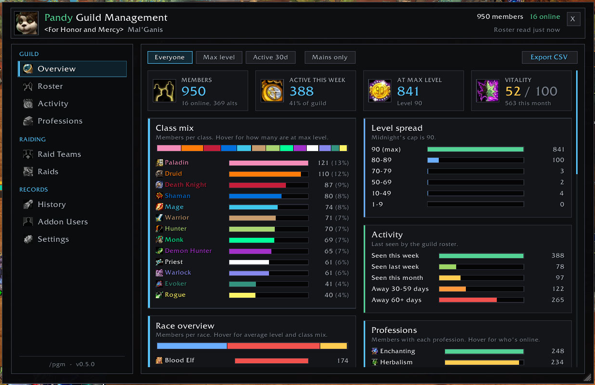
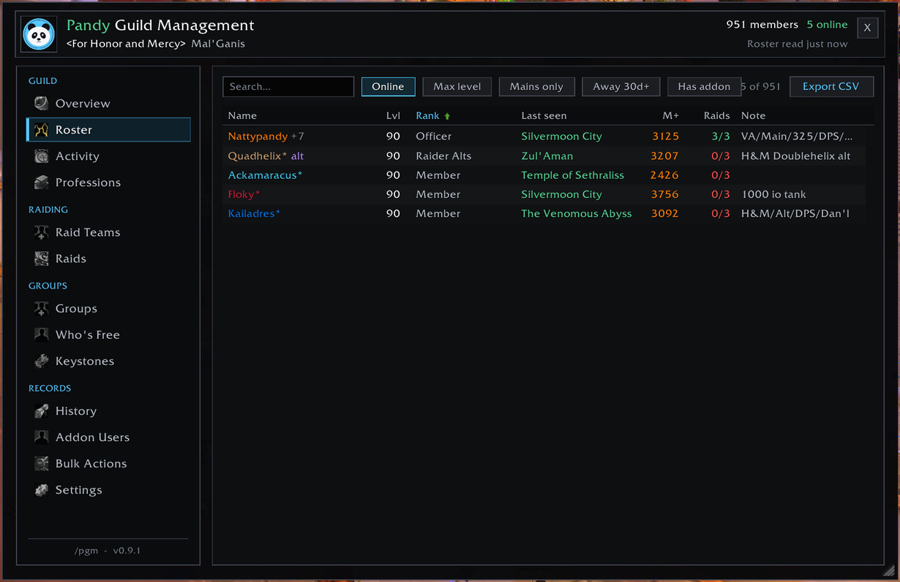
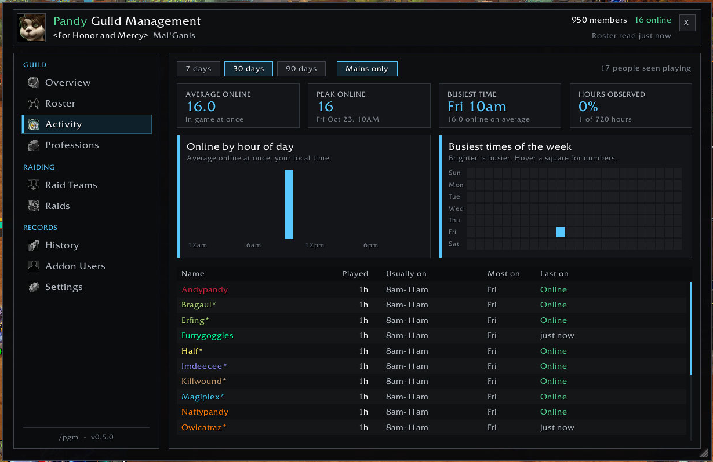
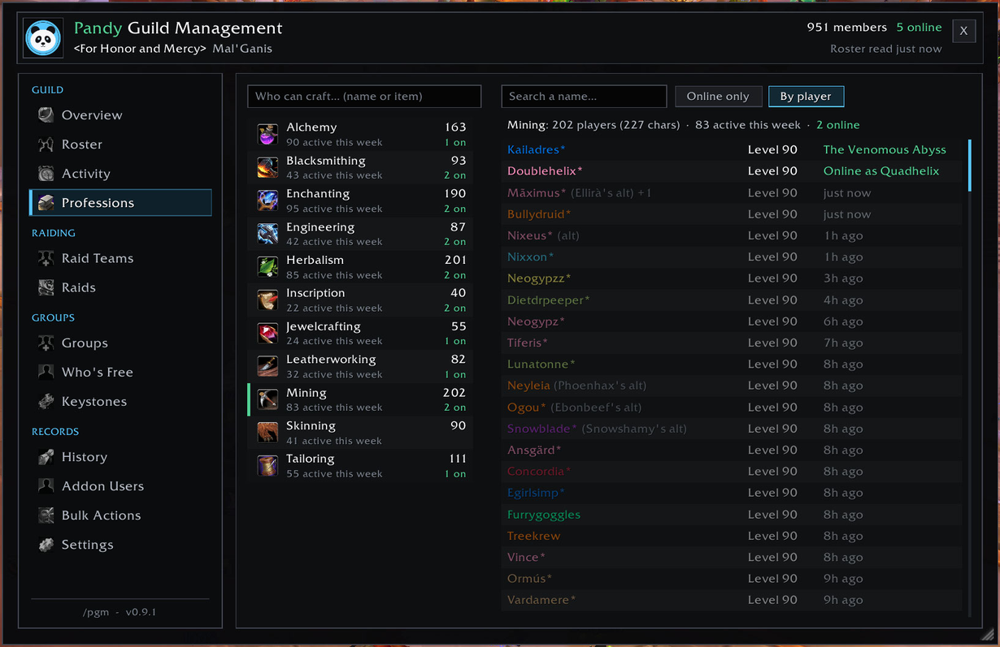
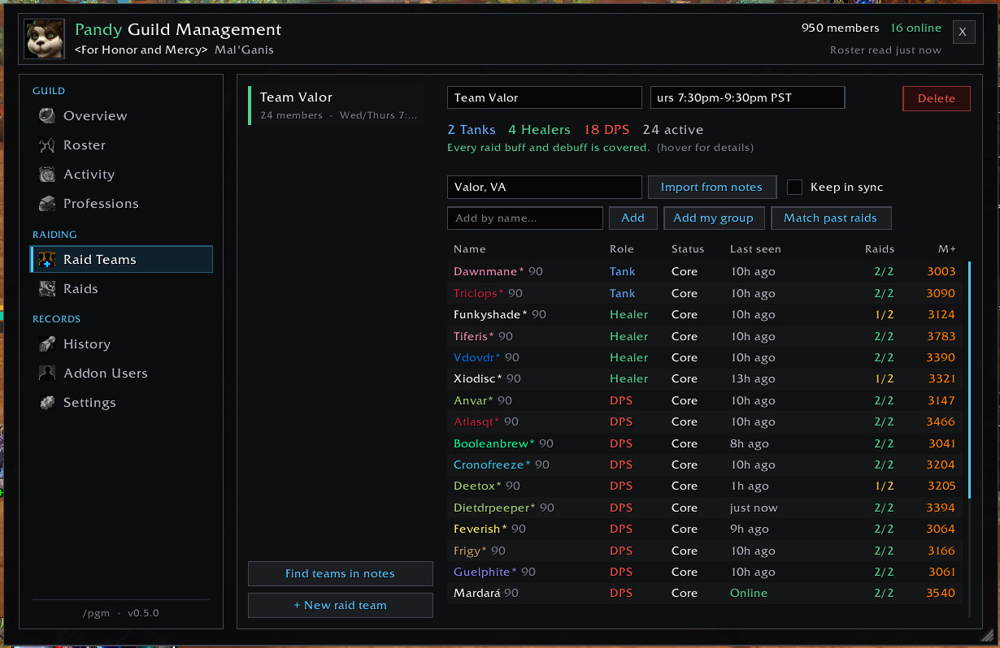
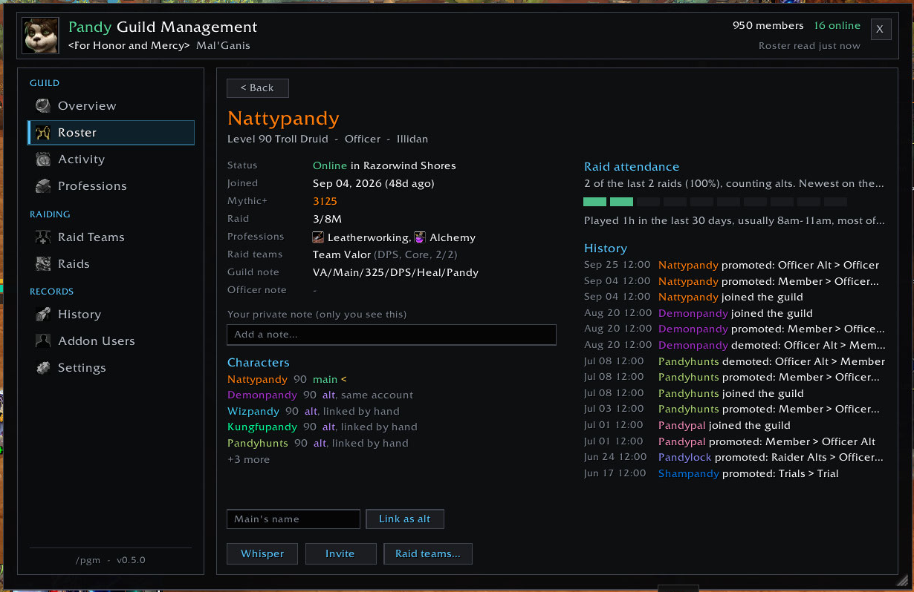
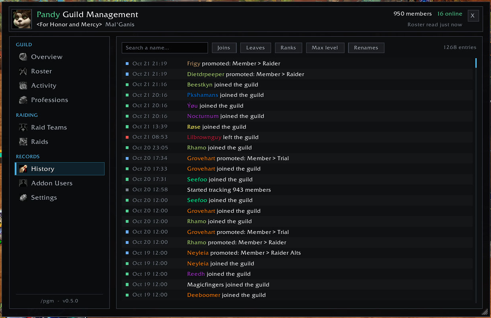
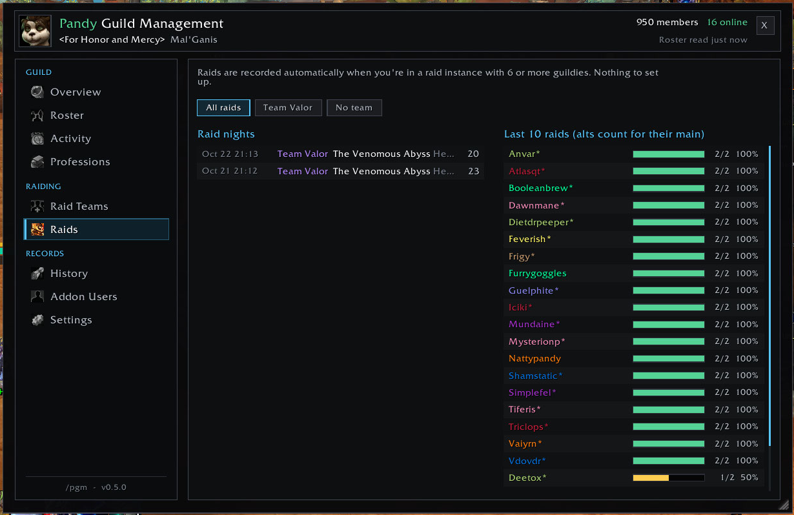
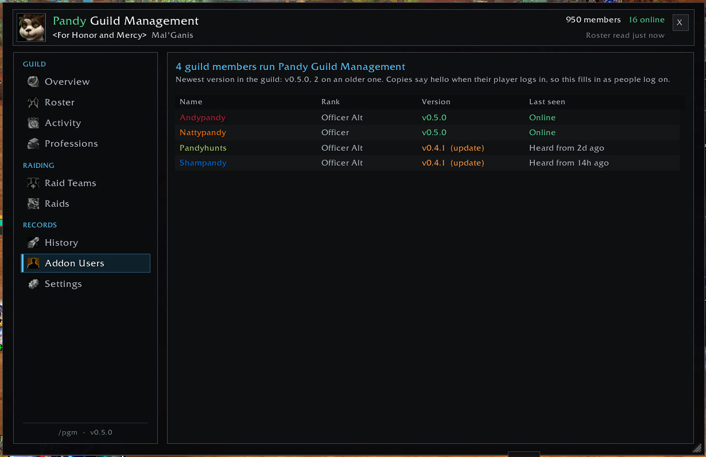
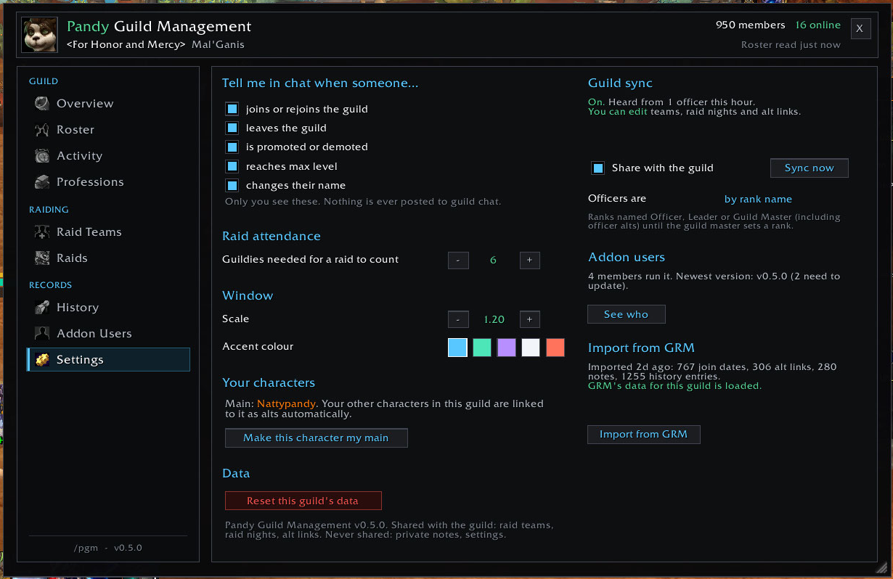

# Pandy Guild Management

A guild manager for retail WoW (Midnight), built for big raiding guilds:

- **Guild overview:** class, race, level and activity breakdowns, professions,
  Mythic+ spread and a vitality score for the whole guild
- **Raid teams:** built automatically from the tags in your guild notes, with
  roles, Core/Trial/Bench, raid-buff coverage and per-team attendance
- **Guild sync:** teams, raid nights and alt links shared with everyone running
  the addon, editable only by officers and raid leaders
- **Alts:** detected from alt ranks, guild-note formats and your own account
- **Raid attendance:** recorded automatically, no setup
- **Play-time activity:** average and peak online, the guild's busiest times,
  and when each member usually plays
- **Roster, professions and history:** searchable, sortable, with safe
  promote/demote buttons

Type `/pgm` (or `/pandy`) to open it, or click it in Blizzard's AddOns button on the minimap.

## Install

1. Open the [latest release](https://github.com/AndyPandyTX/PandyGuildManagement/releases/latest)
   and download `PandyGuildManagement-vX.Y.Z.zip` from **Assets**. Use that
   zip, not GitHub's "Source code" zip.
2. Unzip it into `World of Warcraft\_retail_\Interface\AddOns\`. You should end
   up with `AddOns\PandyGuildManagement\PandyGuildManagement.toc`.
3. Restart WoW, or type `/reload` if it's already running.

To update, do the same with the newer zip, replacing the old folder. Your data
isn't in this folder (it's in WoW's `WTF` folder), so updating never loses it.

## Pages

**Overview.** The guild at a glance:
- Tiles: members, active this week, at max level, and a vitality score out of 100
- Class mix: all 13 classes, in class colours. Hover a bar to see how many are at max level.
- Race overview: coloured by faction. Hover a race for its average level and class mix.
- Level spread: bands under Midnight's level cap
- Activity: seen this week, last week, this month, away 30-59 days, away 60+ days
- Professions: how many members have each one
- Ranks: members per rank, with how many have been away 30+ days
- Mythic+ spread for max-level members
- Where online members are, by zone
- Joins and leaves per week for the last 8 weeks
- Filter to Everyone, Max level or Active 30d, and to Mains only. Export everything as CSV.

**Roster.** A searchable, sortable list. Search covers name, rank, zone,
notes, class, race and profession. Filters for online, max level, mains only
and away 30d+. It shows alts, M+ score and raid attendance; hover a row for
professions and raid teams. Click someone to open their profile; right-click
to whisper or invite.

**Activity.** When the guild plays, and who plays when:
- tiles for average online, peak online (and when), the busiest time of the
  week, and how many hours have been observed
- a chart of average online by hour of day, and a weekday × hour grid that
  lights up at the busiest times
- each member's hours played, usual play time and most active day
- 7, 30 or 90 days, with alts folded into their main

Every copy notes who's in game every 5 minutes; the mobile app doesn't count.
The guild roster shows everyone's online status, so one copy covers the whole
guild while its player is on. Other copies fill in the hours you're not: each
finished hour is shared once, and logging in after time away catches up on up
to a week. Everything is shown in your local time. Each profile also shows
that member's play time.

**Professions.** Pick a profession and see everyone who has it. Online
members are listed first, so finding a crafter right now takes one click.
Click anyone to open the game's recipe view for them, showing every recipe
they know and don't. Alts are marked with their main's name.

**Raid Teams.** Run as many teams as you like:
- Each team has a name, a schedule note and a roster.
- Each member has a role (Tank, Healer or DPS) and a status (Core, Trial or Bench). Click either one to change it.
- Shows the team's makeup and which raid buffs it's missing (Arcane Intellect, Fortitude, Battle Shout and so on).
- Shows each member's attendance at that team's raids only.
- Add people by name, or use "Add my group" during a raid.

**Profile.** Shows:
- Race and class, status, join date, M+ score and raid progress
- Professions, and raid teams (with role and attendance)
- Guild and officer notes, plus a private note only you can see
- Their characters (main and alts), with Link, Unlink and Make main buttons
- Their last 10 raids, as a strip of boxes
- Their history
- Buttons to add them to a raid team, and, if your rank allows it, a rank picker with Set rank (any rank below yours, in one click) and Remove

**History.** Every join, rejoin, leave, promotion, demotion, rename and
max-level ding, with filters.
- **Who did it:** "Zobeast demoted by Nattypandy", "Valarr was removed from
  the guild by Nattypandy", "Seefoo joined the guild (invited by Dazibanu)".
  It comes from the game's own messages while you're online, and from the
  guild event log for anything that happened while you were away.
- **Who they left behind:** when someone leaves or is removed, their
  characters still in the guild are listed ("Still here: Bobalt, Bobbank"),
  in History and in the chat announcement.
- Search finds a name whether they made the change or it happened to them.

**Raids.** Raid nights are recorded automatically when you're in a raid
instance with enough guildies. Each night is tagged to the raid team that
showed up (half or more of its non-bench roster). Right-click a night to
retag it, and use "Match past raids" on the Raid Teams page to tag older ones.
Filter by team; a team's view lists its whole roster, so no-shows appear too.

**Addon Users.** Everyone in the guild running Pandy Guild Management, with
their version, and who needs to update. The Roster also has a "Has addon"
filter.

**Bulk Actions.** Kick, promote or demote many members at once, by rules.
Officers only (the same people who can edit raid teams), and only what the
game lets your rank do:
- Make rules for each action: away at least N days (or online within N
  days, for promotions), ranks, level range, days in the guild, text in
  their notes, and the rank to move them to.
- By default a rule leaves raid team members alone, and for kicks and
  demotions anyone whose alt or main was on recently.
- Everyone the rules pick is listed. Untick someone to leave them alone;
  that's remembered.
- Start, confirm, then press the button or its hotkey (Ctrl-Shift-K, or your
  own). Each press runs the next batch, several people at a time. The game
  only allows these from a real click or key press, one press per batch.
- After each press the roster is read again to confirm who was done. Anything
  that didn't take is tried once more, then marked failed. Removals show in
  History as "was removed from the guild".
- It never lists you, the guild master, or anyone at your rank or above. It
  disarms in combat, when you leave the page and when you close the window.
  Rules aren't shared with the guild.

**Settings.** Choose which changes get announced in chat (only to you, never
to guild chat), how many guildies a raid needs to count, window scale, accent
colour and your main. Guild sync status and the officer cut-off live here, as
does the GRM import.

## Coming from GRM?

With Guild Roster Manager still enabled, open Settings and click **Import from
GRM**. It brings over, for this guild:

- **Alt groups** become alt links, shared with the guild. Officers only.
- **Join dates** fill in "Joined" for everyone. They're shared with the guild
  when an officer imports.
- **Rank history** goes into History as promotions and demotions from before
  this addon was installed.
- **Custom notes** become your private notes, where you don't already have one.

Anything set by hand is kept, and running it again is safe. After that, GRM can
be switched off.

## WoW Forever

The same addon runs on WoW Forever. Everything above works there, except:

- The level cap is 60, so "max level" and the level bands follow that.
- There's no Mythic+, so the M+ score, M+ column and M+ spread are hidden,
  along with RaiderIO raid progress.
- The raid-buff checklist on Raid Teams is hidden, since it lists Midnight's buffs.

Guild data stays separate: a Forever guild and a retail guild never share teams,
raid nights or alts.

## Where the data comes from

- **Guild roster:** name, rank, level, class, zone, notes and last online.
- **Communities roster:** race, Blizzard's Mythic+ score and both primary
  professions with skill. This covers every member, whether or not they run
  this addon. It's the same data the guild window's Professions column shows.
- **RaiderIO (optional):** fills in M+ scores Blizzard didn't give, plus raid progress.

## How alts are found

1. **Your own characters:** any characters on your account in the same guild
   are linked automatically. Your main is the one on a non-alt rank with the
   best M+ score, unless you pick one in Settings. Each character tells the
   guild who its main is, so once you've logged into each of them with the
   addon, everyone sees them linked ("set by the player" on the profile).
   Each character can only speak for itself, and a link only counts once
   the main has also said it's a main, so nobody can claim someone else's
   characters.
2. **Guild notes:** all of these name the main:
   - "alt of Natty", "Natty's alt" and "main: Natty"
   - the slash format many guilds use, like "VA/Alt/258/Crafter/Anvar"
   - on an alt rank, just the main's name, like "NattyPandy"

   The name has to be a real guild member.
3. **Alt ranks:** anyone on a rank like "Raider Alts" or "Officer Alt" counts
   as an alt even when no note names the main. Link them by hand to say whose.
4. **By an officer:** link someone from their profile. An officer's link
   always wins, and "Not an alt" overrides the rank and the player's own
   link.

## Midnight notes

- **No combat log.** Raid attendance samples the raid group once a minute and at every boss kill.
- **Promote, demote and remove use secure buttons.** You click them and they
  run Blizzard's own `/gpromote`, `/gdemote` and `/gremove`. They're hidden in
  combat, and Remove takes two clicks to confirm.
- **Secret values are skipped.** If the game hides roster or unit data
  (during some instanced content), the addon skips that read and nothing
  hidden is ever saved.
- **Guild notes and the MOTD can't be written by addons.** That's why the
  private note exists.

## Guild sync

Everyone in the guild running the addon shares one set of data, over hidden
guild addon messages.

- **Shared with everyone:** raid teams (members, roles, status, note tags,
  schedule), recorded raid nights, alt links made by officers, and which of
  their own characters players have linked.
- **Never shared:** private notes, settings and your accent colour.
- **Who can edit:** officers only. Everyone else sees shared teams and raid
  nights read-only, with the edit buttons hidden. The one thing anyone can
  share is their own characters' main.
  - By default, "officer" means the Guild Master and any rank whose name
    contains Officer or Leader. That covers Officer, Officer Alt, Event Officer
    and Raid Leadership.
  - The guild master can instead pick a cut-off rank in Settings > Guild sync,
    and that choice is sent to everyone.
- **Enforced by every receiver:** each player's addon checks the sender's rank
  in its own guild roster before applying a change. An edited copy on a
  member's PC can't push changes.
- **Merging:** each change carries a timestamp, and the newest wins, one team
  spot or alt link at a time. If two officers record the same raid night, the
  two records merge into one. A member removed from a team by hand stays
  removed for everyone.
- **Catching up:** a player who logs in says how current they are. An officer
  who's online sends them anything newer. Everyone listening merges that same
  catch-up.
- **Inside instances:** Midnight blocks addon messages there, so changes wait
  and go out once you leave.
- **Message budget:** about one message a second. Small records like alt
  links and join dates are packed several to a message. Bulk sends, such as a
  GRM import or a catch-up, go at low priority, so live edits never wait behind
  them. A first-time catch-up can take a few minutes, and brings the 30 most
  recent raid nights.

## Modules

A module is a separate addon that builds on this one: it lists
`## Dependencies: PandyGuildManagement` in its `.toc` and adds pages to this
window, under a **Modules** heading at the bottom of the sidebar.

- **Register:** `PGM.RegisterModule({ name, version, api = 1, slash })`
  returns false if this copy is older than the API the module needs.
- **Pages:** `UI:AddTab({ id, label, build, refresh, module = true, icon })`.
  `/pgm <id>` opens it. `UI:QueueRefresh()` repaints soon after the
  module's own data changes.
- **Sync:** `PGM.SyncRegister(letter, fn)` claims a record letter and
  `PGM.SyncSend(bulk, "1" .. letter, ...)` sends one on the shared queue.
  The core uses `H V O R E T K M A S P D C J B W Y Z`. `G` is Pandy Guild
  Groups', and `F I L N Q U X` are kept for other modules. Module records
  aren't officer-only, so a module checks its own senders. `PGM.SyncBlocked()`
  says when nothing can go out (inside instances).

Within one `PGM.API` number these keep their names, arguments and results:

| Area | Functions |
|---|---|
| Values | `PGM.Plain`, `PGM.Now`, `PGM.Stamp`, `PGM.Print`, `PGM.Debug`, `PGM.GuildDB`, `PGM.GuildKey`, `PGM.opt`, `PGM.IS_FOREVER`, `PGM.MaxLevel`, `PGM.NameLess`, `PGM.SplitName` |
| Look | `PGM.C`, `PGM.Hex`, `PGM.ClassHex`, `PGM.ClassColor`, `PGM.ColorName`, `PGM.AgoText`, `PGM.Date`, `PGM.ROLE_LABEL`, `PGM.ROLE_COLOR` |
| Members | `PGM:MyGuid`, `PGM:MainOf`, `PGM:KnownMain`, `PGM:IsAlt`, `PGM:GroupOf`, `PGM:FindMember`, `PGM:MPlusScore`, `PGM:ScoreColor` |
| Teams | `PGM:Teams`, `PGM:TeamById`, `PGM:TeamsOf` |
| Officers | `PGM:CanEdit`, `PGM:IsOfficerRec` |
| Events | `PGM:On` with `LOGIN`, `ROSTER`, `TEAMS`, `SYNC` |
| Sync | `PGM.SyncSend`, `PGM.SyncRegister`, `PGM.SyncBlocked`, `PGM.SyncNorm`, `PGM.SyncIsMe`, `PGM.SyncHandlers` |
| Window | `UI:AddTab`, `UI:Show`, `UI:Refresh`, `UI:QueueRefresh`, `UI:MemberMenu`, `UI:OpenProfile`, `UI:Whisper`, `UI:Invite`, the widgets in `UI.W` |

`PGM` is the global `PandyGuildManagement`, and `UI` is `PGM.UI`.

## Not included (yet)

- **Recipe-level lookups** ("who can craft this exact item"). Only profession names are shown.
- **Loot tracking.** Midnight doesn't really allow it.
